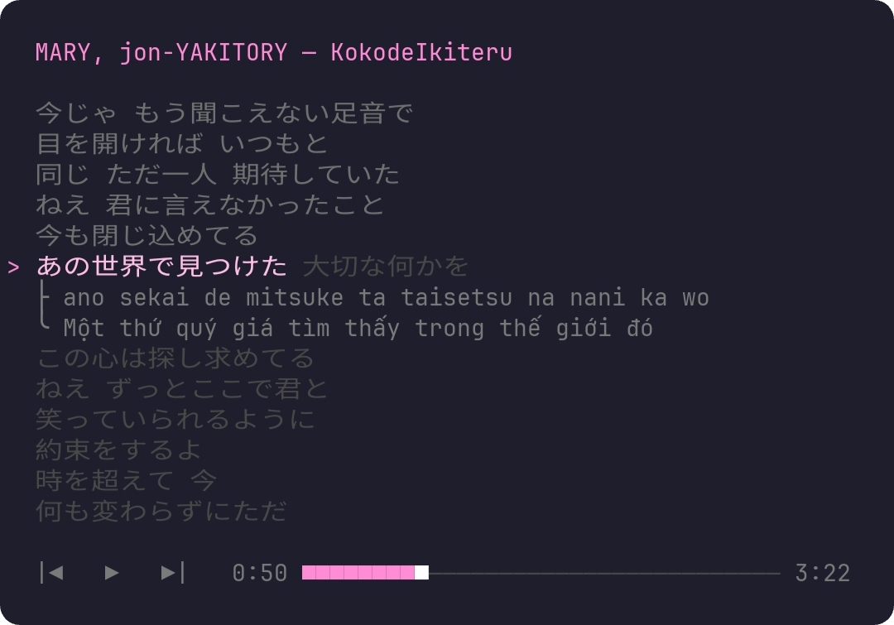
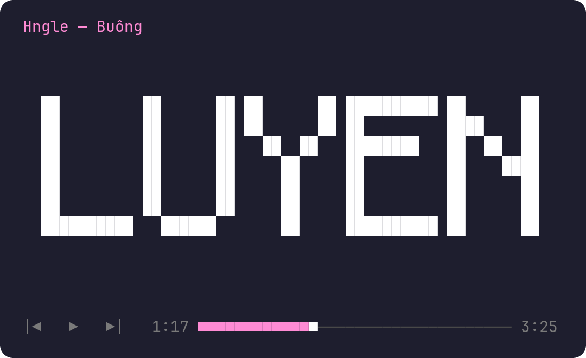
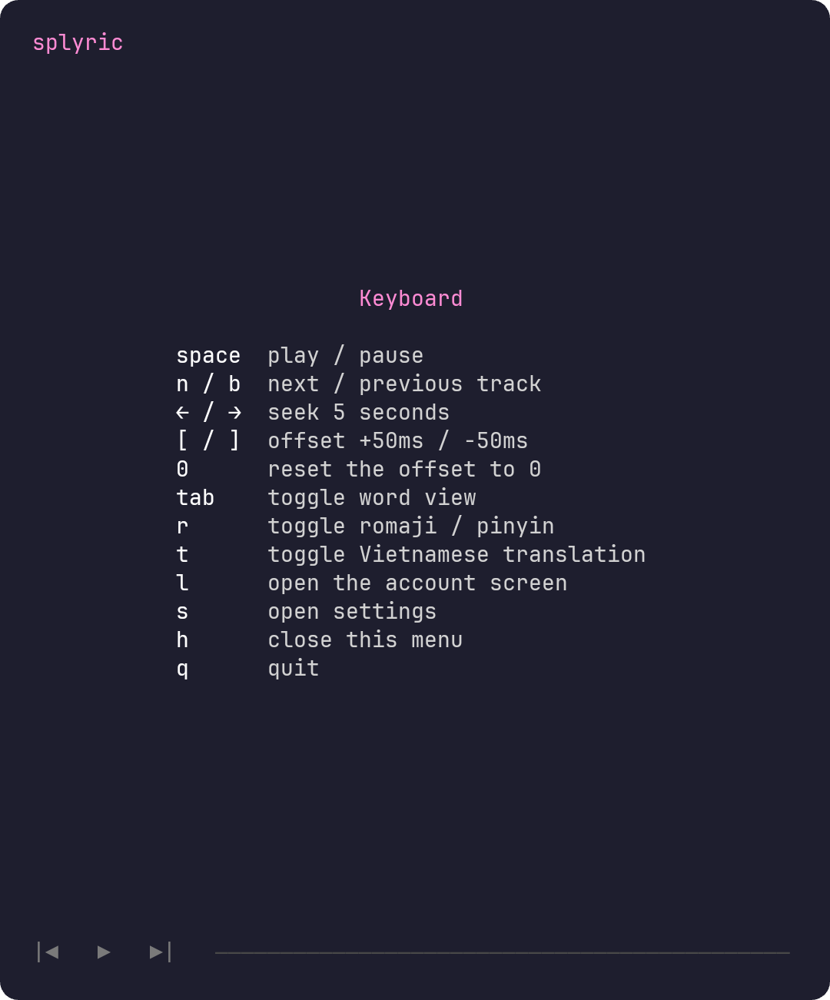
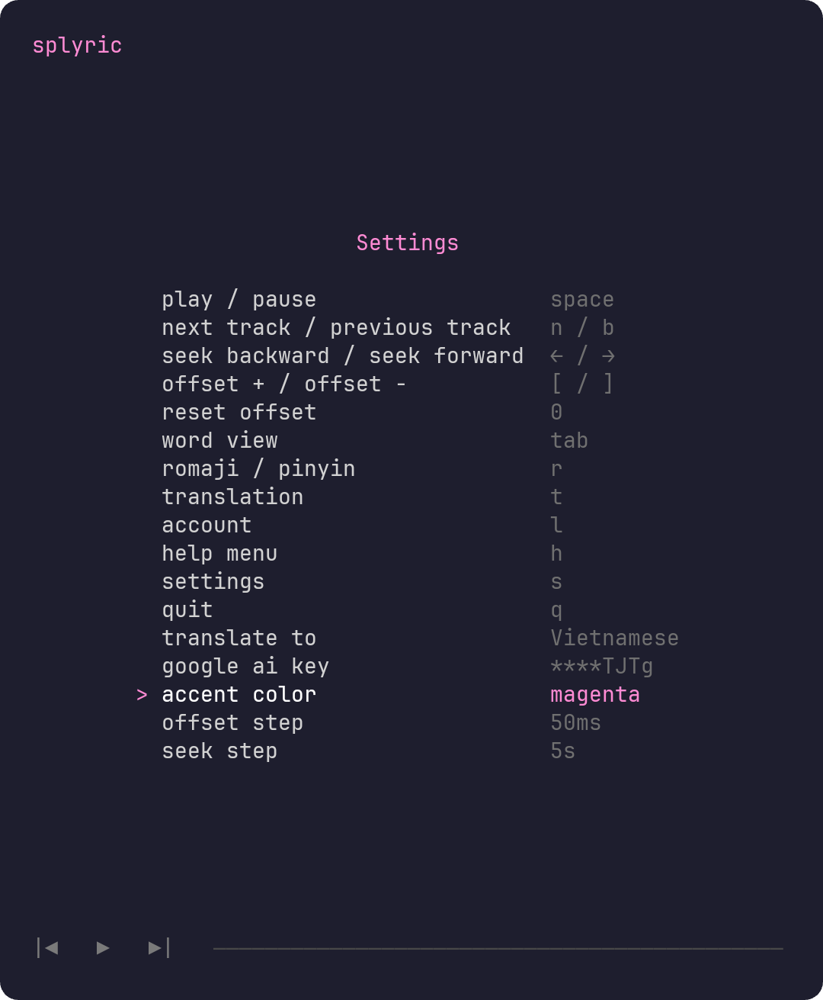

**splyric** is a terminal lyrics viewer for whatever Spotify is playing: every **word** lights up the moment it is sung — no GUI, no web.

> ⚠️ Lyrics follow the position Spotify reports over its API, not the audio you hear: **<100 ms** off the API clock, **0.5–1.5 s** off your speakers. Nudge them with `[` / `]` (stored per track).



Press **tab** for word view — one word at a time, drawn as a big pixel block:



## ⚙️ Install

Requires [Node.js](https://nodejs.org/) v22.18+ — it runs TypeScript natively.

```sh
git clone https://github.com/Kitosium/splyric.git
cd splyric
npm install
```

## 🔑 Setup

Copy `.env.example` to `.env` and fill in your Spotify app credentials:

```sh
cp .env.example .env
```

Add `http://127.0.0.1:8889/callback` as a Redirect URI in the [Spotify Developer Dashboard](https://developer.spotify.com/dashboard). Then start the app:

```sh
npm start
```

On first run the app shows a sign-in URL: open it, approve, and lyrics start syncing. On another machine press `p` and paste the full redirect URL. Later runs reuse the stored token; `l` + `enter` signs out.

## 🎹 Keys

| Key             | Action                                                 |
| --------------- | ------------------------------------------------------ |
| Mouse           | hover a button, click to press, click the bar to seek  |
| `space`         | play / pause                                           |
| `n` / `b`       | next / previous track                                  |
| `←` / `→`       | seek backward / forward                                |
| `[` / `]`       | lyrics ±50 ms (earlier / later), `0` resets the offset |
| `tab`           | lyric view ↔ word view                                 |
| `r` / `t`       | romaji / pinyin · translation (Vietnamese by default)  |
| `s` / `l` / `h` | settings · account · on-screen key menu                |
| `q`             | quit                                                   |

Every key is rebindable and every step size adjustable in settings (`s`); toasts confirm each action on the title row.



## 🎛️ Settings

Press `s`: `↑ ↓` picks a row, `← →` changes it, `enter` rebinds a key or opens the AI-key input, `esc` closes. Saves go live to `~/.config/splyric/set.json` — edit it by hand, or delete it to reset every default.



## 🔧 Environment

`.env` next to `package.json`, or plain environment variables — leave an entry empty to keep its default:

| Var            | Default                    | Meaning                                                |
| -------------- | -------------------------- | ------------------------------------------------------ |
| `SPY_CID`      | —                          | **required** Spotify Client ID                         |
| `SPY_CS`       | —                          | Client Secret (optional)                               |
| `SPY_PORT`     | `8889`                     | OAuth callback port                                    |
| `SPY_POLL`     | `2000`                     | poll interval in ms — keep ≥ 1000 (429s since 02/2026) |
| `SPY_SRC`      | `lrclib,mxm,spot,ytc`      | lyric sources in order                                 |
| `SPY_STYLE`    | `reveal`                   | `reveal` (ghosted) or `highlight`                      |
| `SPY_DC`       | —                          | `sp_dc` cookie → color lyrics                          |
| `SPY_DIR`      | `~/.config/splyric`        | token, cache, offsets, settings, log                   |
| `SPY_AMB`      | `1`                        | set `2` if `■ ▶ —` render double-width                 |
| `SPY_AI_URL`   | —                          | OpenAI-compatible base URL for AI translation          |
| `SPY_AI_KEY`   | —                          | its key — or type it in settings (`s` → google ai key) |
| `SPY_AI_MODEL` | `gemini-flash-lite-latest` | its model id                                           |

## 🎼 Lyrics sources

| #   | Source               | Sync        | Needs               |
| --- | -------------------- | ----------- | ------------------- |
| 1   | LRCLIB               | word / line | —                   |
| 2   | Musixmatch richsync  | word        | may throttle per IP |
| 3   | Spotify color-lyrics | line        | `SPY_DC`            |
| 4   | YouTube captions     | word        | `yt-dlp` in `PATH`  |

A word-level hit stops the search, a failure falls through to the next source, and results are cached 30 days in `~/.config/splyric/lyr/`.

## 🤝 Contributing

Issues and pull requests are welcome. Dev loop: `npm run fmt` · `npm run check` · `npm test`. Log file: `~/.config/splyric/log.txt`. Released under the [MIT License](LICENSE).
